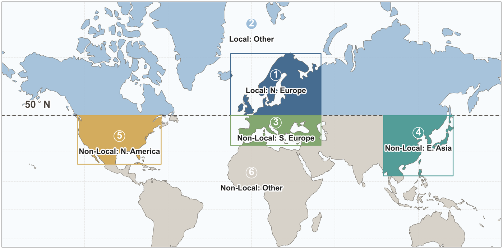
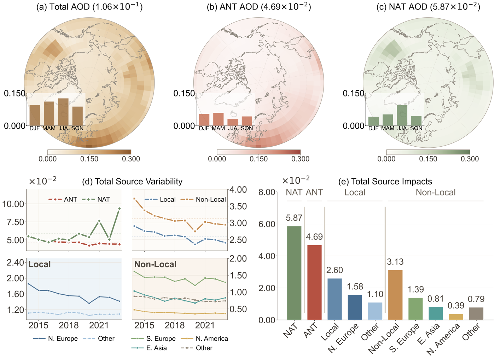
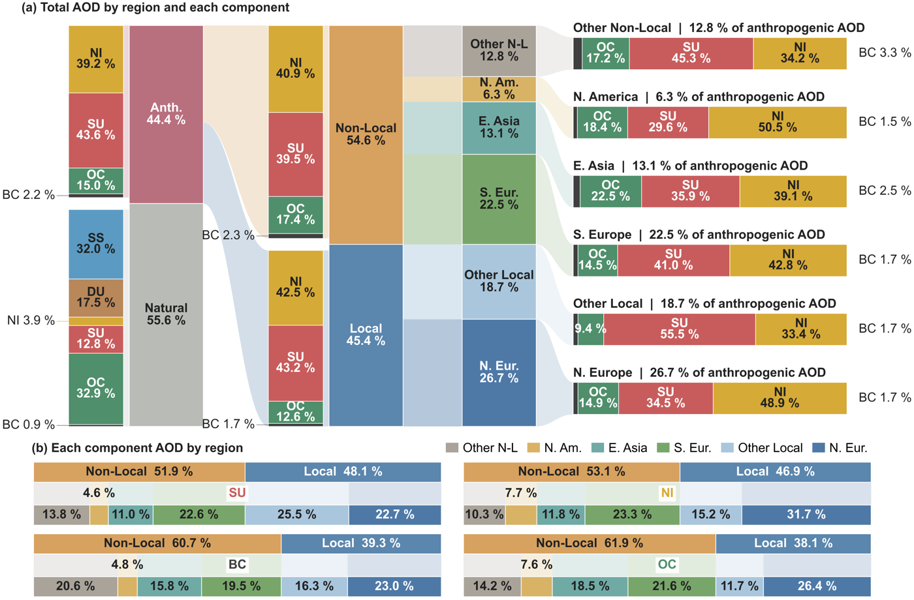
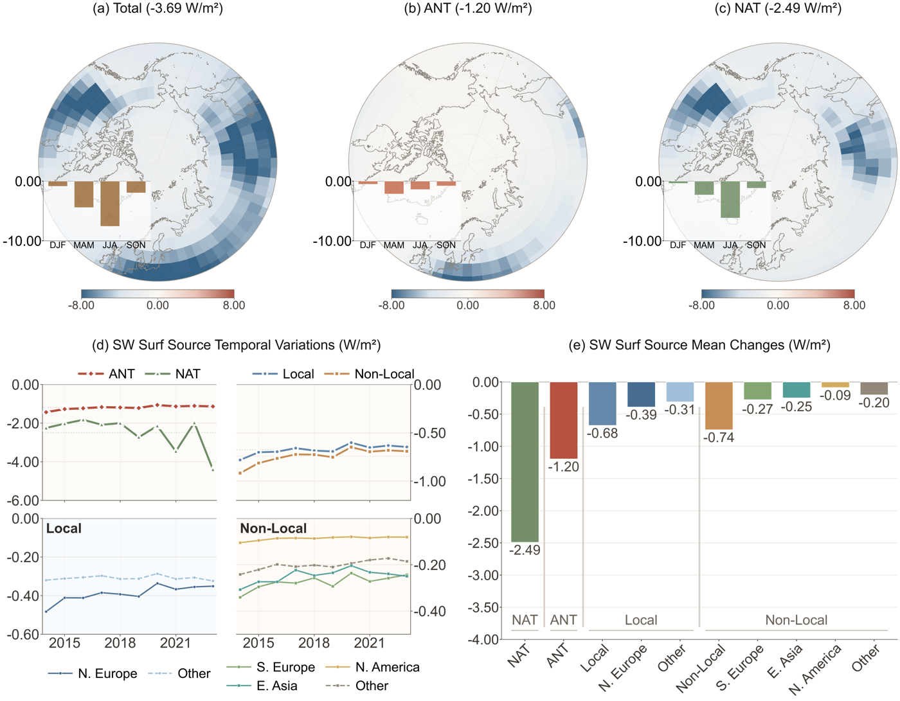
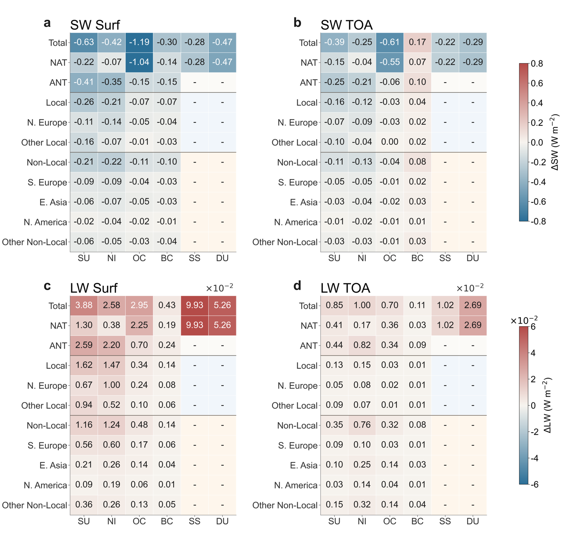

# Pan-Arctic aerosol AOD and direct radiative effects, 2014–2023

Analysis code, processed data and figure exports accompanying:

> **Distinguishing aerosol direct radiative effects from local and nonlocal anthropogenic emissions across pan-Arctic regions during 2014–2023**  
> Ruiman Geng, Jia Tao, Hao Zhou, Chengfeng Meng, Jinfeng Ding, Lei Liu and Xiaoqian Zhu.

This archive reproduces **Figures 1–5 and Supplementary Figures S1–S34** of the associated manuscript. It contains 39 figure scripts, 24 scientific NetCDF files, one NetCDF file of map geometry, and 39 PNG/PDF figure pairs. The source experiments distinguish anthropogenic and natural aerosols, local and nonlocal anthropogenic emissions, six emission regions, and aerosol components.

**Version:** `v1.0.0` · **Archive date:** 18 November 2026 · **Analysis period:** 2014–2023.

## Download code, data and figures

- **Code and documentation:** this Git repository.
- **All 25 NetCDF files:** individual assets on the [v1.0.0 release](https://github.com/raymen677/arctic-aerosol-aod-dre-2014-2023/releases/tag/v1.0.0); total size approximately **1.92 GB**. Their filenames, relative paths and SHA-256 hashes are listed in [data_manifest.json](data_manifest.json).
- **Complete publication figure exports:** [figures_png_pdf_v1.0.0.zip](https://github.com/raymen677/arctic-aerosol-aod-dre-2014-2023/releases/download/v1.0.0/figures_png_pdf_v1.0.0.zip), approximately **272 MB**, containing all 78 PNG/PDF files under `figures/main/` and `figures/supplementary/`. File and archive hashes are listed in [figures_manifest.json](figures_manifest.json).
- **Figure previews:** the five smaller images in [`preview/`](preview/) are for browsing; use the Release archive for the full resolution files.

Large scientific files are distributed through GitHub Releases. A normal `git clone` retrieves the scripts, documentation and previews; download the NetCDF assets before running the scripts. Git LFS is not required.

## Quick start

### 1. Get the code

```bash
git clone https://github.com/raymen677/arctic-aerosol-aod-dre-2014-2023.git
cd arctic-aerosol-aod-dre-2014-2023
```

### 2. Download and verify the NetCDF inputs

Run the following Python code **from the repository root** (for example, save it locally as a temporary script and run it). It uses only the Python standard library, creates the required `data/` directories, skips files that already pass verification, and checks every downloaded file against its SHA-256 hash.

```python
from pathlib import Path
import hashlib
import json
import urllib.request

def sha256(path):
    digest = hashlib.sha256()
    with path.open("rb") as stream:
        for block in iter(lambda: stream.read(8 * 1024 * 1024), b""):
            digest.update(block)
    return digest.hexdigest()

manifest = json.loads(Path("data_manifest.json").read_text(encoding="utf-8"))
for item in manifest["files"]:
    target = Path(item["path"])
    target.parent.mkdir(parents=True, exist_ok=True)
    if target.exists() and sha256(target) == item["sha256"]:
        print("Verified:", target)
        continue
    temporary = target.with_name(target.name + ".part")
    print("Downloading:", target)
    urllib.request.urlretrieve(item["download_url"], temporary)
    if sha256(temporary) != item["sha256"]:
        raise RuntimeError(f"Checksum mismatch: {target}")
    temporary.replace(target)
    print("Verified:", target)
```

These downloads total approximately 1.92 GB. Keep the relative directory structure defined by the manifest; placing all NetCDF files in one directory will not match the script paths.

### 3. Create a Python environment

The figures were verified with **Python 3.13.11** and the exact package versions in [requirements.txt](requirements.txt).

```bash
python -m venv .venv
```

Activate the environment using `.venv\Scripts\Activate.ps1` in Windows PowerShell, or `source .venv/bin/activate` on Linux/macOS, then install the packages:

```bash
python -m pip install -r requirements.txt
```

Arial was used for the verified exports. A system without Arial may substitute another font; install an appropriate font or adjust the figure font settings if the appearance must match the archived exports. Fonts are not bundled in this repository.

### 4. Generate a figure

```bash
python -B fig1_region.py
python -B fig2_arctic_aod.py
python -B fig3_aod_source_attribution.py
python -B fig4_surface_shortwave_dre.py
python -B fig5_dre_component_source_heatmap.py
python -B figs8_nitrate_aod.py
```

All paths are resolved relative to the scripts, so scripts can also be called by their absolute paths from another working directory. Outputs are written to `figures/main/` or `figures/supplementary/`. Existing exports with the same names are replaced. `-B` prevents Python bytecode cache files.

To generate every numbered figure from PowerShell:

```powershell
Get-ChildItem -File -Filter 'fig*.py' | Sort-Object Name | ForEach-Object {
    python -B $_.FullName
    if ($LASTEXITCODE -ne 0) { throw "Figure generation failed: $($_.Name)" }
}
```

Or from a POSIX shell:

```bash
for script in fig*.py; do
    python -B "$script" || exit 1
done
```

The full run generates 39 figures and their PDF counterparts. Some scripts import shared functions from other figure scripts; retain all 39 scripts together. Common export and offline map functions reside in `fig1_region.py`.

## Directory structure after downloading the assets

```text
arctic-aerosol-aod-dre-2014-2023/
  README.md
  requirements.txt
  data_manifest.json
  figures_manifest.json
  SHA256SUMS
  fig1_region.py
  fig2_arctic_aod.py
  fig3_aod_source_attribution.py
  fig4_surface_shortwave_dre.py
  fig5_dre_component_source_heatmap.py
  figs1_*.py ... figs34_*.py
  preview/                    Five smaller previews for this README
  data/
    aod/                      Ten monthly AOD experiment files
    radiation/                Ten monthly radiation experiment files
    observations/             Four AERONET/MAN/MERRA-2/CERES files
    geography/                Natural Earth geometry stored as NetCDF
  figures/
    main/                     Figures 1–5, PNG and PDF
    supplementary/            Figures S1–S34, PNG and PDF
```

## Scientific data and conventions

### Model experiments

The manuscript reports GEOS-Chem Classic v14.6.2 coupled with RRTMG, HEMCO v3.9.2, a 4° latitude × 5° longitude grid, 47 vertical layers, and the period 2014–2023. The distributed model files contain processed monthly two-dimensional diagnostics on a 46 × 72 latitude/longitude grid, with 120 monthly time steps.

The ten AOD files and ten radiation files represent the same experiment design: BASE, natural emissions only (NAT), and eight anthropogenic source-removal experiments. Anthropogenic effects are diagnosed as **BASE − NAT**; a source contribution is **BASE − the corresponding source-removal experiment**. Natural effects use NAT directly. Local and nonlocal source definitions are separated at 50°N. Exact spatial selections and averaging conventions remain those used in each figure script.

| AOD file in `data/aod/` | Radiation file in `data/radiation/` | Anthropogenic source removed |
|---|---|---|
| `aod_gc_base.nc` | `rad_gc_L0_base.nc` | None; BASE includes anthropogenic and natural emissions |
| `aod_gc_noall.nc` | `rad_gc_L1_noall.nc` | All anthropogenic sources; NAT |
| `aod_gc_nonp.nc` | `rad_gc_L2_local_nonp.nc` | Local sources |
| `aod_gc_nonp_sup.nc` | `rad_gc_L2_trans_nonp_sup.nc` | Nonlocal sources |
| `aod_gc_no_north_europe.nc` | `rad_gc_L3_local_no_north_europe.nc` | Northern Europe |
| `aod_gc_no_north_europe_sup.nc` | `rad_gc_L3_local_no_north_europe_sup.nc` | Other local areas |
| `aod_gc_no_south_europe.nc` | `rad_gc_L3_trans_no_south_europe.nc` | Southern Europe |
| `aod_gc_no_east_asia.nc` | `rad_gc_L3_trans_no_east_asia.nc` | Eastern Asia |
| `aod_gc_no_north_america.nc` | `rad_gc_L3_trans_no_north_america.nc` | Northern America |
| `aod_gc_no_three_regions_sup.nc` | `rad_gc_L3_trans_no_three_regions_sup.nc` | Other nonlocal areas |

Zero-out source perturbations can be non-additive. Figure 3 normalizes displayed fractions within their parent category; do not interpret every displayed percentage as a fraction of the same denominator.

### Variables and units

- AOD is dimensionless at **550 nm**. Model variables use the `RadAOD550nm_*` names.
- `PM` denotes total aerosol AOD or total aerosol radiative diagnostics; it is not a surface PM mass concentration in this archive.
- `SU`: sulfate; `BC`: black carbon; `OA`/`OC`: organic aerosol/organic carbon labels used in the original scripts; `DU`: dust; `SS`: sea salt.
- The figure label **NI** retains the original script definition **AM + NI** (ammonium plus nitrate diagnostics). It is not silently replaced by the standalone NI variable during archiving.
- Radiative diagnostics use `RadAllSky{SW,LW}{Surf,TOA}_*` and the corresponding clear-sky names. DRE and radiation fluxes are in **W m⁻²**.
- Preserve the sign and all-sky/clear-sky conventions in the scripts. Some longwave annotations and heatmap values use a scale factor displayed on the figure.
- Regional averages use cosine-latitude weighting in the original analyses. Pairing, interpolation, time averaging and station selection are defined by the relevant validation scripts.

### Evaluation inputs

| File in `data/observations/` | Contents and provenance recorded in the file |
|---|---|
| `aod_aeronet_monthly_v3.nc` | NASA AERONET Version 3, Level 2.0 monthly AOD; 1,442 stations and 120 monthly records before script-level selection |
| `All_MAN_Data_V3_AOD_Level20.nc` | AERONET Maritime Aerosol Network Version 3, Level 2.0 observations; the scripts select the study period and geographic domain |
| `aod_merra2_components.nc` | Processed MERRA-2 total and component AOD; 120 time records on a 361 × 576 grid; file metadata records VersionID 5.12.4 and product DOI `10.5067/FH9A0MLJPC7N` |
| `rad_ceres_monthly.nc` | Processed CERES SYN1deg-Month radiative fluxes; Terra-Aqua-NOAA20 Edition4B; 111 available monthly records on a 180 × 360 grid |

Temporal coordinates, available records, variables and source metadata are preserved in the supplied NetCDF files. The original AERONET/MAN, MERRA-2 and CERES providers should be acknowledged and cited when these inputs are reused.

The additional `data/geography/natural_earth_geometry.nc` file stores cached Natural Earth map geometry as hexadecimal WKB strings with EPSG:4326 coordinates. It is used for offline basemaps and contains no simulation values. Map features can therefore be drawn without downloading shapefiles at run time. Natural Earth is the source of the map geometry.

## Figure-to-code mapping

Each listed script generates the identically named `.png` and `.pdf`. Supplementary figure filenames use the lowercase `figs` prefix.

| Figure | Script | Description |
|---|---|---|
| 1 | [fig1_region.py](fig1_region.py) | Anthropogenic emission regions and local/nonlocal masks |
| 2 | [fig2_arctic_aod.py](fig2_arctic_aod.py) | Total, anthropogenic and natural pan-Arctic AOD |
| 3 | [fig3_aod_source_attribution.py](fig3_aod_source_attribution.py) | Hierarchical AOD attribution and component source fractions |
| 4 | [fig4_surface_shortwave_dre.py](fig4_surface_shortwave_dre.py) | Surface shortwave aerosol direct radiative effects |
| 5 | [fig5_dre_component_source_heatmap.py](fig5_dre_component_source_heatmap.py) | Surface and TOA shortwave and longwave component DRE heatmaps |
| S1 | [figs1_aeronet_station_validation.py](figs1_aeronet_station_validation.py) | AERONET eight-station AOD evaluation and station map |
| S2 | [figs2_aeronet_land_man_validation.py](figs2_aeronet_land_man_validation.py) | AERONET land and MAN ocean AOD validation |
| S3 | [figs3_merra2_aod_scatter.py](figs3_merra2_aod_scatter.py) | MERRA-2 total and component AOD scatter evaluation |
| S4 | [figs4_merra2_aod_spatial_bias.py](figs4_merra2_aod_spatial_bias.py) | MERRA-2 total and component AOD spatial biases |
| S5 | [figs5_ceres_radiation_scatter.py](figs5_ceres_radiation_scatter.py) | CERES surface and TOA shortwave/longwave radiation evaluation |
| S6 | [figs6_ceres_all_sky_spatial.py](figs6_ceres_all_sky_spatial.py) | All sky CERES radiation spatial evaluation |
| S7 | [figs7_ceres_clear_sky_spatial.py](figs7_ceres_clear_sky_spatial.py) | Clear sky CERES radiation spatial evaluation |
| S8 | [figs8_nitrate_aod.py](figs8_nitrate_aod.py) | Nitrate AOD spatial and temporal patterns |
| S9 | [figs9_black_carbon_aod.py](figs9_black_carbon_aod.py) | Black carbon AOD spatial and temporal patterns |
| S10 | [figs10_organic_carbon_aod.py](figs10_organic_carbon_aod.py) | Organic carbon AOD spatial and temporal patterns |
| S11 | [figs11_sulfate_aod.py](figs11_sulfate_aod.py) | Sulfate AOD spatial and temporal patterns |
| S12 | [figs12_natural_sea_salt_dust_aod.py](figs12_natural_sea_salt_dust_aod.py) | Natural sea-salt and dust AOD |
| S13 | [figs13_aod_component_source_heatmap.py](figs13_aod_component_source_heatmap.py) | AOD component and emission-region contribution heatmap |
| S14 | [figs14_total_toa_shortwave_dre.py](figs14_total_toa_shortwave_dre.py) | Total TOA shortwave DRE |
| S15 | [figs15_total_surface_longwave_dre.py](figs15_total_surface_longwave_dre.py) | Total surface longwave DRE |
| S16 | [figs16_total_toa_longwave_dre.py](figs16_total_toa_longwave_dre.py) | Total TOA longwave DRE |
| S17 | [figs17_nitrate_surface_shortwave_dre.py](figs17_nitrate_surface_shortwave_dre.py) | Nitrate surface shortwave DRE |
| S18 | [figs18_nitrate_toa_shortwave_dre.py](figs18_nitrate_toa_shortwave_dre.py) | Nitrate TOA shortwave DRE |
| S19 | [figs19_nitrate_surface_longwave_dre.py](figs19_nitrate_surface_longwave_dre.py) | Nitrate surface longwave DRE |
| S20 | [figs20_nitrate_toa_longwave_dre.py](figs20_nitrate_toa_longwave_dre.py) | Nitrate TOA longwave DRE |
| S21 | [figs21_black_carbon_surface_shortwave_dre.py](figs21_black_carbon_surface_shortwave_dre.py) | Black carbon surface shortwave DRE |
| S22 | [figs22_black_carbon_toa_shortwave_dre.py](figs22_black_carbon_toa_shortwave_dre.py) | Black carbon TOA shortwave DRE |
| S23 | [figs23_black_carbon_surface_longwave_dre.py](figs23_black_carbon_surface_longwave_dre.py) | Black carbon surface longwave DRE |
| S24 | [figs24_black_carbon_toa_longwave_dre.py](figs24_black_carbon_toa_longwave_dre.py) | Black carbon TOA longwave DRE |
| S25 | [figs25_organic_carbon_surface_shortwave_dre.py](figs25_organic_carbon_surface_shortwave_dre.py) | Organic carbon surface shortwave DRE |
| S26 | [figs26_organic_carbon_toa_shortwave_dre.py](figs26_organic_carbon_toa_shortwave_dre.py) | Organic carbon TOA shortwave DRE |
| S27 | [figs27_organic_carbon_surface_longwave_dre.py](figs27_organic_carbon_surface_longwave_dre.py) | Organic carbon surface longwave DRE |
| S28 | [figs28_organic_carbon_toa_longwave_dre.py](figs28_organic_carbon_toa_longwave_dre.py) | Organic carbon TOA longwave DRE |
| S29 | [figs29_sulfate_surface_shortwave_dre.py](figs29_sulfate_surface_shortwave_dre.py) | Sulfate surface shortwave DRE |
| S30 | [figs30_sulfate_toa_shortwave_dre.py](figs30_sulfate_toa_shortwave_dre.py) | Sulfate TOA shortwave DRE |
| S31 | [figs31_sulfate_surface_longwave_dre.py](figs31_sulfate_surface_longwave_dre.py) | Sulfate surface longwave DRE |
| S32 | [figs32_sulfate_toa_longwave_dre.py](figs32_sulfate_toa_longwave_dre.py) | Sulfate TOA longwave DRE |
| S33 | [figs33_natural_dust_dre.py](figs33_natural_dust_dre.py) | Natural dust surface and TOA shortwave and longwave DRE |
| S34 | [figs34_natural_sea_salt_dre.py](figs34_natural_sea_salt_dre.py) | Natural sea-salt surface and TOA shortwave and longwave DRE |

## Export quality and validation

The archived outputs were regenerated from the supplied NetCDF files and compared with the final manuscript and supplementary figures.

- All **39 figure scripts completed successfully** in the recorded environment.
- PNG exports have **1000 dpi** metadata and widths of **7481–7483 pixels**; they were rendered from the underlying plotting objects, not enlarged from the manuscript bitmaps.
- PDFs are **190.00 mm wide**, preserve proportional height, and have embedded fonts. Text and line work remain vector objects; some map color fields are rasterized according to the original plotting method.
- The 24 scientific NetCDF files were preserved byte for byte during organization. SHA-256 hashes are supplied for the distributed data, figures and code.
- Downloaded or regenerated figure files can be checked against [figures_manifest.json](figures_manifest.json). Exact byte hashes for regenerated PDFs may differ across environments or exports even when the scientific content is unchanged.

For a faster local draft, `EP_EXPORT_DPI` can temporarily be set to a smaller value. Remove that variable, or set it to `1000`, before producing submission figures. A draft export replaces files with matching names in the output directory.

## Main figure previews

These previews are reduced in size for online browsing; the full resolution PNG and PDF versions are in the [v1.0.0 release](https://github.com/raymen677/arctic-aerosol-aod-dre-2014-2023/releases/tag/v1.0.0).

**Figure 1. Anthropogenic emission regions and local/nonlocal masks.**



**Figure 2. Total, anthropogenic and natural pan-Arctic AOD.**



**Figure 3. Hierarchical AOD attribution and component source fractions.**



**Figure 4. Surface shortwave aerosol direct radiative effects.**



**Figure 5. Surface and TOA shortwave and longwave component DRE heatmaps.**



## Scope, citation and contact

This is an archive of processed figure inputs, analysis/plotting code and the numbered figure exports. It is not a complete GEOS-Chem source-code checkout or a complete set of run-directory configurations, emissions and meteorological inputs for rerunning the simulations. The unnumbered graphical abstract and editable manuscript files are not included.

When using this archive, cite the associated manuscript and the specific repository release. Publication details and any permanent archival DOI should be added when available; this repository does not assign or imply a DOI.

**Associated manuscript authors:** Ruiman Geng, Jia Tao, Hao Zhou, Chengfeng Meng, Jinfeng Ding, Lei Liu and Xiaoqian Zhu. Ruiman Geng and Jia Tao contributed equally, as stated in the manuscript.

**Corresponding author:** Hao Zhou, College of Meteorology and Oceanography, National University of Defense Technology; `zhouhao23a@nudt.edu.cn`.

No repository-wide license has been assigned in this release. Third-party data retain the terms and attribution requirements of their original providers.
